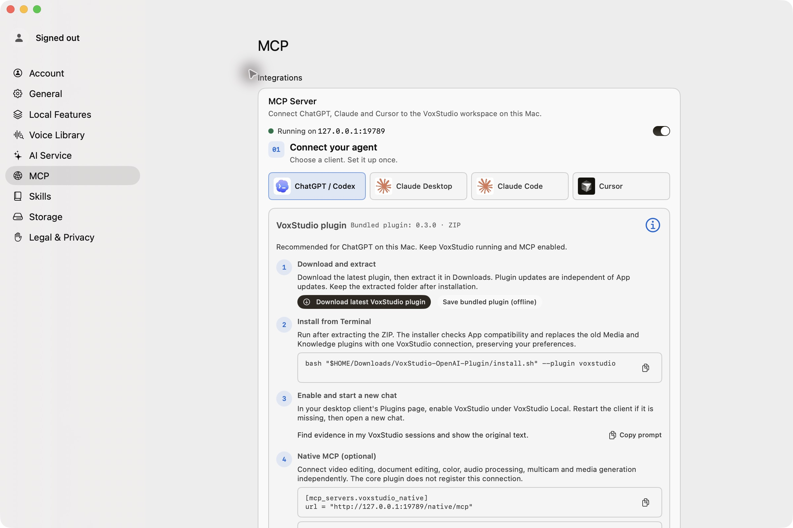

# VoxStudio MCP Media Guide

Connect VoxStudio Web Cloud or the VoxStudio Mac app to ChatGPT, Codex, or Claude for multimedia knowledge search, source checking, and creative follow-up workflows.

> **Tested configuration:** VoxStudio for Mac 7.0.49 (139), bundled VoxStudio plugin 0.3.0, checked 2026-11-08. The current Mac app’s MCP setup screen and public product guides were reviewed. This environment had no authenticated VoxStudio Cloud MCP tools, so Cloud account search and citation fetch are documented but not reported as end-to-end tested here.

## Choose the right connection

| Connection | Endpoint | Library | Mac app must stay open? | Can edit a Mac video timeline? |
| --- | --- | --- | --- | --- |
| VoxStudio Web Cloud MCP | https://voxstudio.me/cloud/mcp | Sessions in the authorized VoxStudio Cloud account | No | No |
| VoxStudio Mac core MCP | http://127.0.0.1:19789/chatgpt/mcp for the ChatGPT/Codex setup, or http://127.0.0.1:19789/app/mcp for Claude | The local VoxStudio library on this Mac | Yes; client and Mac app must be on the same Mac | No |
| VoxStudio Mac Native MCP | http://127.0.0.1:19789/native/mcp | Local Mac projects and media | Yes; client and Mac app must be on the same Mac | **Yes** |

Cloud and Mac MCP are separate connections with separate libraries and authorization. Use Native MCP as a separate server when the task must change a local timeline. Installing the core plugin does not add the Native MCP connection.

## What you can do

### Search and cite recording evidence

Ask about one named session or search across the authorized library. Request a concise answer with the session, timestamp, and source passage. Then open the cited transcript passage in VoxStudio and read or replay enough surrounding context to check the answer.

A useful prompt:

> Search my VoxStudio recordings for the discussion of [topic]. Return the session title, timestamp, a short original passage, and a concise answer. Separate direct evidence from inference. If the passage does not support a claim, say so.

For decisions and action items, ask the assistant to compare sources and preserve disagreement:

> Compare the decision in [meeting A] with [meeting B]. Quote the relevant passages with timestamps, identify what changed, and mark anything that is not explicit in the recordings.

### Turn evidence into a new creative asset

After checking the original, reuse the verified material as a source for a script, outline, subtitle draft, voiceover, or short-form edit brief. Keep the source transcript and newly generated copy distinct. Cloud MCP can search and process cloud media; it cannot edit the Mac app’s timeline.

For video editing from local Mac media, connect Native MCP separately and use a new project or timeline. See the [Codex video editing demo](https://github.com/metaswang/voxstudio-codex-video-editing).

## Client setup

### VoxStudio Web Cloud MCP

Cloud MCP uses one remote HTTPS endpoint. Authorize the VoxStudio account in the client’s OAuth flow; do not paste a password or access token into a chat or repository.

| Client | Setup |
| --- | --- |
| ChatGPT web | In a ChatGPT Business, Enterprise, or Edu workspace, an admin/authorized developer can add a custom MCP server from **Plugins → Add custom MCP server**. Use https://voxstudio.me/cloud/mcp, complete the available authentication flow, review the tool list, then test the connection. Plan and workspace controls apply. |
| Codex | Add the remote server with <code>codex mcp add voxstudio_cloud --url https://voxstudio.me/cloud/mcp</code>, then check it with <code>codex mcp list</code>. If you use the VoxStudio Cloud plugin from the plugin catalog, avoid creating a duplicate connection to the same endpoint. |
| Claude Desktop | In **Settings → Connectors**, add a custom connector using https://voxstudio.me/cloud/mcp, then authorize it. Anthropic currently documents remote MCP connectors for Pro, Max, Team, and Enterprise plans. |
| Claude Code | Run <code>claude mcp add --transport http voxstudio_cloud https://voxstudio.me/cloud/mcp</code>, then check with <code>claude mcp list</code> and <code>/mcp</code>. Complete OAuth if the client requests it. |

ChatGPT custom MCP connections are documented for Business and Enterprise/Edu workspaces on ChatGPT web. Claude remote connectors require a supported plan. Availability and workspace policies can change; use the client’s current setup screen if its labels differ.

### VoxStudio Mac core MCP

Keep VoxStudio open and enable **Settings → MCP**. The installed app’s screen is the version-matched source of truth for its current client steps and plugin download.

- **ChatGPT / Codex:** In **Settings → MCP → ChatGPT / Codex**, download and extract the current plugin. The checked release displayed this installer command:

      bash "$HOME/Downloads/VoxStudio-OpenAI-Plugin/install.sh" --plugin voxstudio

  Then enable **VoxStudio Local** in the client’s Plugins page and start a new chat. The displayed core URL is http://127.0.0.1:19789/chatgpt/mcp. The bundled plugin was 0.3.0 when checked; get a fresh download from VoxStudio Settings if the packaged version changes.
- **Claude Desktop:** In **Settings → MCP → Claude Desktop**, use **Install in Claude Desktop**, then enable the connector. The displayed URL is http://127.0.0.1:19789/app/mcp.
- **Claude Code:** In **Settings → MCP → Claude Code**, copy the version-matched command. The checked release displayed:

      claude mcp add --transport http voxstudio http://127.0.0.1:19789/app/mcp

Local MCP endpoints use loopback; they are for a client running on the same Mac as VoxStudio, not a public server URL.

### Add timeline editing with Native MCP

Connect this separately when you want an assistant to create or edit a local Mac timeline. The checked Mac setup screen displayed:

    [mcp_servers.voxstudio_native]
    url = "http://127.0.0.1:19789/native/mcp"

Follow the live **Native MCP** instructions in VoxStudio Settings → MCP and your client. Re-read the current project in the Native connection before making edits. Do not assume Cloud source IDs or temporary grants work in a separate local connection.

## Practical workflow

1. Pick Cloud MCP for cloud sessions or Mac core MCP for the local library.
2. Ask a narrow question and request timestamps plus original passages.
3. Open the cited source and verify the surrounding transcript or play the media.
4. Draft the new script, outline, captions, or edit brief from verified passages.
5. For a Mac timeline edit, connect Native MCP separately, create a new timeline, and inspect the result before export.

## Verification notes

- **Checked in VoxStudio UI:** Mac app version 7.0.49 (139); MCP server running at 127.0.0.1:19789; bundled plugin 0.3.0; client-specific setup screens for ChatGPT/Codex, Claude Desktop, and Claude Code.
- **Live edit workflow verified:** a separate public NASA demo project was edited with Native MCP and exported as H.264. See the [Codex demo](https://github.com/metaswang/voxstudio-codex-video-editing).
- **Not verified in this session:** authenticated Cloud library search/citation fetch and sign-in-based client connections. The Cloud connection was not exposed to this Codex session. The documented Cloud endpoint and client setup are linked below so readers can verify them in their own account.
- **Do not treat an AI answer as the source:** follow the citation, check the original passage, and keep uncertainty or conflicting evidence visible.

## Official guides

- [Search Cloud recordings with ChatGPT and check the source](https://voxstudio.me/blog/search-cloud-recordings-with-chatgpt)
- [Ask your recordings a question. Check the source.](https://voxstudio.me/blog/ask-chatgpt-and-claude-about-your-recordings)
- [Cut clips from a long video without listening to it again](https://voxstudio.me/blog/make-a-short-video-with-an-ai-assistant)
- [VoxStudio Web](https://voxstudio.me/)
- [VoxStudio for Mac](https://voxstudio.me/mac)
- [ChatGPT custom MCP server setup](https://help.openai.com/en/articles/12584461-connecting-custom-mcp-servers-in-chatgpt)
- [Codex MCP setup example](https://developers.openai.com/learn/docs-mcp)
- [Claude remote MCP connectors](https://support.anthropic.com/en/articles/11175166-about-custom-integrations-using-remote-mcp)
- [Claude Code MCP setup](https://code.claude.com/docs/en/mcp)

## License and media

Original documentation and prompts in this repository are licensed under [CC BY 4.0](LICENSE). Product names, trademarks, screenshots, and linked third-party media retain their owners’ rights. See [MEDIA-CREDITS.md](MEDIA-CREDITS.md).

## 简体中文摘要

本指南区分 VoxStudio Web Cloud MCP、Mac 本地核心 MCP 与单独的 Native 编辑 MCP。Cloud 用于云端会话检索、来源引用回查及媒体工作流；Mac 核心 MCP 访问本机知识库；只有 Mac Native MCP 能编辑本机视频时间线。当前版本为 Mac 7.0.49 (139)，于 2026-11-08 核对。Cloud 账户查询未在本会话实测，连接步骤请以各客户端和 VoxStudio 设置页当前界面为准。
